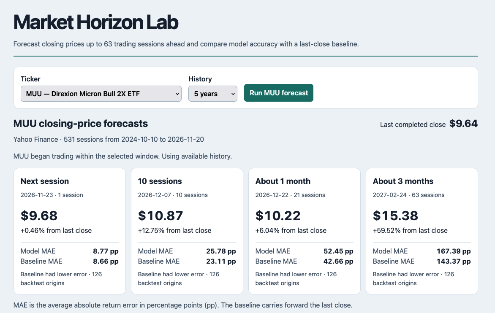
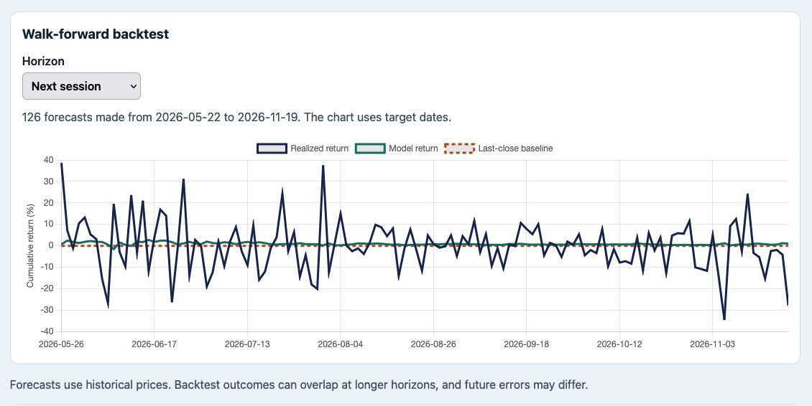
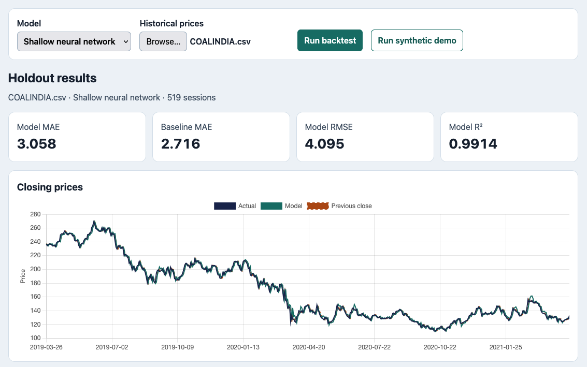

# Market Horizon Lab

Forecast closing prices 1, 10, 21, or 63 trading sessions ahead and see how each model performed against the last-close baseline. Market Horizon Lab is a React and FastAPI dashboard for selected U.S.-listed tickers, including SOXL, MUU, GDXU, NVIDIA, Intel, and Alphabet. It defaults to one year of daily history and also supports three months, six months, and five years.

[GitHub Repository](https://github.com/nayeel-imtiaz/market-horizon-lab) · **Live Demo** pending deployment verification

## Tech Stack

- **Frontend:** React
- **Backend:** Python and FastAPI
- **Forecasting:** scikit-learn
- **Market data:** yfinance

## Forecast Preview



MUU forecasts using 531 available trading sessions through Nov. 20, 2026. The last-close baseline had lower backtest error at all four horizons.




## Architecture

- **Vercel** serves the Create React App build. The browser connects directly to the HTTPS API using the build-time `REACT_APP_API_URL`.
- **Render** runs one Uvicorn worker for the FastAPI API. It fetches completed daily bars from Yahoo Finance and fits scikit-learn models on demand. The `/health` route is independent of market data and model training.
- **GitHub Actions** verifies both applications. GitHub branch protection and the hosts’ native GitHub integrations control releases.

## Run locally

Use Python 3.12 and Node.js 24 with npm. From the repository root, start the API in one terminal.

```bash
python3 -m venv .venv
source .venv/bin/activate
python -m pip install -r requirements.txt
python -m uvicorn backend.main:app --reload
```

From the repository root, start the frontend in a second terminal.

```bash
cd frontend
npm ci
npm start
```

Open [the dashboard](http://localhost:3000), pick a ticker, keep **1 year** selected, and click the forecast button. Yahoo Finance supplies daily bars through yfinance. The backend fetches them on demand for local personal use without an API key. This feature requires internet access. Open [the API docs](http://localhost:8000/docs) to try `GET /market-forecast?symbol=SOXL&lookback=1y` directly.

If Yahoo Finance is unavailable, expand **CSV backtest and synthetic demo** to try the original workflow. The CSV needs 60–10,000 daily rows for one symbol, with `Date` in `YYYY-MM-DD` format and a positive numeric `Close`.

Local development defaults to `http://localhost:8000`. For a different API origin, copy `frontend/.env.example` to `frontend/.env.local` and set `REACT_APP_API_URL` before restarting the frontend. For production, set the public HTTPS API origin in Vercel. The value is visible in the browser bundle.

## CI/CD and deployment

The **Backend tests** and **Frontend checks** jobs run on PRs targeting `main` and pushes to `main`. Backend tests use deterministic and mocked market data. Frontend CI runs ESLint, Jest, and the production build. Render waits for CI on `main`. Vercel tracks `main` as its production branch, so each merge triggers a production build.

1. **GitHub.** Publish this change and wait for both jobs to report in **Actions**. In the repository, open **Settings → Branches → Add branch protection rule**. Set the pattern to `main`. Enable **Require a pull request before merging**, **Require status checks to pass before merging**, and **Require branches to be up to date before merging**. Select **Backend tests** and **Frontend checks**. Enable **Do not allow bypassing the above settings** if the owner should also use PRs. [GitHub branch protection](https://docs.github.com/en/repositories/configuring-branches-and-merges-in-your-repository/managing-protected-branches/about-protected-branches)
2. **Render.** Choose **New → Blueprint**, connect the GitHub repository, and select `main` and `render.yaml`. Enter the exact Vercel production origin for `CORS_ALLOWED_ORIGINS` if already assigned. To bootstrap before Vercel assigns a domain, enter `https://pending.invalid` temporarily. Apply the Blueprint, wait for the API to start, and copy the assigned HTTPS origin. Verify `/health` returns `{"status":"ok"}`. [Render Blueprint reference](https://render.com/docs/blueprint-spec)
3. **Vercel.** Choose **Add New → Project** and import the same GitHub repository. Set **Root Directory** to `frontend` and select **Create React App**. Use Node.js 24. The checked-in settings run `npm ci` and `npm run build` and serve `build`. Add `REACT_APP_API_URL` in the **Production** environment with the Render HTTPS origin, excluding any endpoint path. Deploy, confirm production branch tracking is set to `main`, and copy the production domain. If **Deployment Checks** are available on your plan, require both GitHub CI jobs there too so Vercel waits for post-merge CI before promoting. [Vercel Git deployments](https://vercel.com/docs/git) · [Deployment Checks](https://vercel.com/docs/deployment-checks)
4. **Connect and verify.** In Render, set `CORS_ALLOWED_ORIGINS` to the Vercel production origin and redeploy. Use a comma-separated list for additional exact origins. Preview deployments need their own configured API origin and an allowlisted frontend origin if they need live API access. Confirm the production page opens while signed out. Run a SOXL forecast with a one-year and a five-year lookback, then run the synthetic demo. In the browser’s Network panel, confirm requests go to the Render HTTPS origin and return successfully. After that, link the verified production domain under **Live Demo**.

The Render free instance can take about a minute to wake after 15 idle minutes. The frontend allows up to 90 seconds and lets visitors retry. Yahoo requests use a 10-second network timeout, and the API admits one forecast or CSV backtest at a time per worker. Extra concurrent compute requests get a retryable `503`. The forecast, demo, and CSV routes also share a limit of 10 requests per client IP and 60 requests overall in a rolling minute. Over-limit requests receive `429` with `Retry-After`. Health checks and the ticker catalog stay available. Limits are in memory and restart with the single Render worker. Start with one worker and check latency and memory in Render. If cold starts or resource limits hurt the demo, try an always-on instance sized to the observed load before adding a cache or job queue. [Render free-instance behavior](https://render.com/docs/free)

Confirm public display rights for the market data before enabling the public demo. yfinance documents Yahoo Finance data access as intended for personal use. If public display is outside the permitted use, use a provider licensed for public display. [yfinance data-use notice](https://ranaroussi.github.io/yfinance/)

## Forecast methodology

- **Data and calendar.** Use completed regular trading sessions and derive features from Yahoo Finance's adjusted closes. Report the latest quoted close and anchor dollar forecasts to that close. The exchange calendar skips holidays and handles early closes. Forecasts are estimates for four target dates.
- **Model.** Fit a separate ridge regression for each horizon. Each model predicts cumulative log return from historical returns and volatility. Refit on all labels available at the latest close to generate the upcoming forecast.
- **Evaluation.** Walk forward over up to 126 recent origins per horizon. At each origin, fit the scaler and model using only labels whose target dates have occurred by that close. Compare predicted and realized cumulative returns in percentage points of MAE. The baseline predicts a zero return at every horizon.
- **History requirements.** Longer horizons need more history because training labels take longer to mature. For a ticker with a known listing date inside the selected lookback, the dashboard uses the available sessions and shows the actual dates. The dashboard marks horizons with too little data and reports how many forecasts were scored.

## Limitations

Forecasts are experimental and are provided for educational purposes. They are not financial advice.

- Backtest scores measure historical accuracy. Future forecast errors can differ as market conditions change.
- The last-close baseline can outperform ridge regression, as it did at all four horizons in the MUU example above.
- Forecasts from neighboring dates can share much of the same return window, especially at longer horizons.

## Further reading

- **Walk-forward evaluation.** See how rolling forecast origins preserve time order and evaluate errors at different horizons. [Forecasting: Principles and Practice](https://otexts.com/fpp3/tscv.html)
- **Ridge regression.** Learn how the penalty on model coefficients regularizes linear regression. [Scikit-learn user guide](https://scikit-learn.org/stable/modules/linear_model.html#ridge-regression-and-classification)
- **Direct multi-step forecasting.** Read how fitting a model for each horizon differs from repeatedly applying a one-step forecast. [Ben Taieb and Hyndman, ICML 2014](https://proceedings.mlr.press/v32/taieb14.html)

## Original CSV backtest

Next-session closing-price backtest on historical Coal India data. The model
and previous-close baseline are evaluated over the same holdout dates.



On 519 held-out Coal India trading sessions, the shallow neural network had an MAE of 3.058, compared with 2.716 for the previous-close baseline. The baseline produced smaller errors on average.

<details>
<summary>View training and validation error</summary>


</details>

## Verification

```bash
python -m pip install -r requirements-dev.txt
python -m pytest -q
cd frontend
npm ci
npm run lint
npm test -- --watchAll=false --runInBand
REACT_APP_API_URL=http://localhost:8000 npm run build
```

- [Market data and exchange calendar](backend/market.py)
- [Multi-horizon model and walk-forward evaluation](backend/market_forecast.py)
- [Forecast dashboard](frontend/src/App.jsx)
- [Original research notebooks](jupyter_files/)
