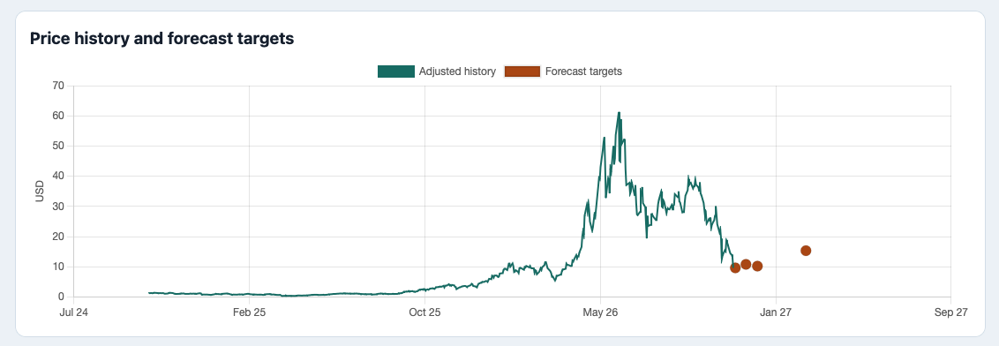
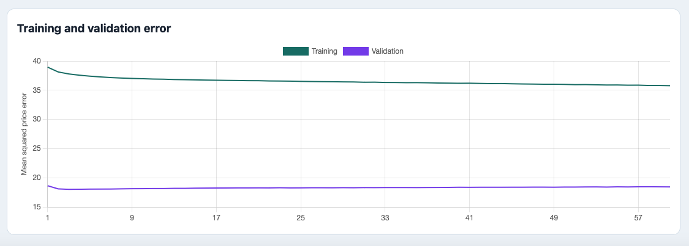

# Market Horizon Lab

Forecast closing prices 1, 10, 21, or 63 trading sessions ahead and see how each model performed against the last-close baseline. Market Horizon Lab is a React and FastAPI dashboard for selected U.S.-listed tickers, including SOXL, MUU, GDXU, NVIDIA, Intel, and Alphabet. It defaults to one year of daily history and also supports three months, six months, and five years.

## Tech Stack

- **Frontend:** React
- **Backend:** Python and FastAPI
- **Forecasting:** scikit-learn
- **Market data:** yfinance

## Forecast Preview


MUU forecasts using 531 available trading sessions through Nov. 20, 2026. The last-close baseline had lower backtest error at all four horizons.




## Run locally

Use Python 3.12 and Node.js with npm. From the repository root, start the API in one terminal.

```bash
python3 -m venv .venv
source .venv/bin/activate
python -m pip install -r requirements.txt
python -m uvicorn backend.main:app --reload
```

From the repository root, start the frontend in a second terminal.

```bash
cd frontend
npm ci
npm start
```

Open [the dashboard](http://localhost:3000), pick a ticker, keep **1 year** selected, and click the forecast button. Yahoo Finance supplies daily bars through yfinance. The backend fetches them on demand for local personal use without an API key. This feature requires internet access. Open [the API docs](http://localhost:8000/docs) to try `GET /market-forecast?symbol=SOXL&lookback=1y` directly.

If Yahoo Finance is unavailable, expand **CSV backtest and synthetic demo** to try the original workflow. The CSV needs 60–10,000 daily rows for one symbol, with `Date` in `YYYY-MM-DD` format and a positive numeric `Close`.

## Forecast methodology

- **Data and calendar.** Use completed regular trading sessions and derive features from Yahoo Finance's adjusted closes. Report the latest quoted close and anchor dollar forecasts to that close. The exchange calendar skips holidays and handles early closes. Forecasts are estimates for four target dates.
- **Model.** Fit a separate ridge regression for each horizon. Each model predicts cumulative log return from historical returns and volatility. Refit on all labels available at the latest close to generate the upcoming forecast.
- **Evaluation.** Walk forward over up to 126 recent origins per horizon. At each origin, fit the scaler and model using only labels whose target dates have occurred by that close. Compare predicted and realized cumulative returns in percentage points of MAE. The baseline predicts a zero return at every horizon.
- **History requirements.** Longer horizons need more history because training labels take longer to mature. For a ticker with a known listing date inside the selected lookback, the dashboard uses the available sessions and shows the actual dates. The dashboard marks horizons with too little data and reports how many forecasts were scored.

## Limitations

- Backtest scores measure historical accuracy. Future forecast errors can differ as market conditions change.
- The last-close baseline can outperform ridge regression, as it did at all four horizons in the MUU example above.
- Forecasts from neighboring dates can share much of the same return window, especially at longer horizons.

## Further reading

- **Walk-forward evaluation.** See how rolling forecast origins preserve time order and evaluate errors at different horizons. [Forecasting: Principles and Practice](https://otexts.com/fpp3/tscv.html)
- **Ridge regression.** Learn how the penalty on model coefficients regularizes linear regression. [Scikit-learn user guide](https://scikit-learn.org/stable/modules/linear_model.html#ridge-regression-and-classification)
- **Direct multi-step forecasting.** Read how fitting a model for each horizon differs from repeatedly applying a one-step forecast. [Ben Taieb and Hyndman, ICML 2014](https://proceedings.mlr.press/v32/taieb14.html)

## Original CSV backtest

Next-session closing-price backtest on historical Coal India data. The model
and previous-close baseline are evaluated over the same holdout dates.


On 519 held-out Coal India trading sessions, the shallow neural network had an MAE of 3.058, compared with 2.716 for the previous-close baseline. The baseline produced smaller errors on average.

<details>
<summary>View training and validation error</summary>



</details>

## Verification

```bash
python -m unittest backend.test_market_forecast
cd frontend
npm run build
```

- [Market data and exchange calendar](backend/market.py)
- [Multi-horizon model and walk-forward evaluation](backend/market_forecast.py)
- [Forecast dashboard](frontend/src/App.jsx)
- [Original research notebooks](jupyter_files/)
